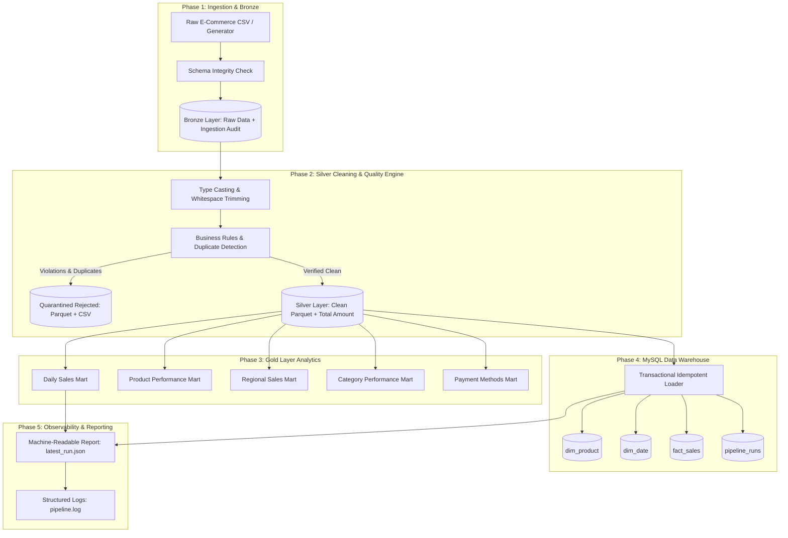

# RetailPulse — End-to-End Retail Data Engineering & Analytics Pipeline

[](https://www.python.org/)
[](https://spark.apache.org/)
[](https://www.mysql.com/)
[]()
[]()

**RetailPulse** is an enterprise-inspired batch retail data engineering pipeline and analytical data warehouse. Built with **PySpark 3.5**, **Apache Parquet**, and **MySQL 8/9**, it models the complete lifecycle of messy e-commerce transaction data: ingestion, validation, quarantine, deduplication, dimensional modeling, and analytical reporting.

Designed specifically to demonstrate practical data engineering rigor, distributed computing fundamentals, and production reliability for the **micro1 Big Data Engineer** technical evaluation.

---

## 1. Architecture Overview

RetailPulse couples the **Medallion Lakehouse Architecture** (Bronze, Silver, Gold) with a **Kimball Star Schema Data Warehouse**:



---

## 2. Key Features

- **Medallion Lakehouse Pattern**:
  - **Bronze**: Raw data preservation with UTC ingestion audit timestamps.
  - **Silver**: Explicit schema enforcement, string trimming, financial decimal precision, and deterministic window-based deduplication (`DUPLICATE_ORDER_ID`).
  - **Gold**: Pre-computed business metrics stored as columnar Parquet with Snappy compression.
- **Data Quality & Bad Record Quarantine**:
  - Bad records (missing customer IDs, invalid dates, negative quantities, negative prices, missing product names) are never silently discarded. They are routed to `data/rejected/` with explicit diagnostic error codes.
  - 100% mathematical reconciliation: $\text{Input Records} = \text{Silver Clean} + \text{Quarantined Rejected}$.
- **Kimball Star Schema Data Warehouse**:
  - Hosted on MySQL 8/9 (`retailpulse_dw`).
  - Features `dim_product` (surrogate keys), `dim_date` (integer date keys), `fact_sales` (transaction grain), and `pipeline_runs` (operational audit trail).
  - Transactional batch upserts guarantee idempotency; rerunning the pipeline refreshes facts without duplicating records.
- **Reliability & Testing**:
  - 18 automated unit and integration tests using `pytest`.
  - Machine-readable JSON execution reports (`reports/latest_run.json`).
  - Structured console and rotating file logging (`logs/pipeline.log`).
- **Graceful Offline Mode**:
  - Supports `--skip-mysql` to run all Spark and Parquet transformations on environments without an active MySQL server.

---

## 3. Technology Stack

| Category | Technology | Rationale |
| :--- | :--- | :--- |
| **Language** | Python 3.9 / 3.11 | Standard data engineering runtime. |
| **Distributed Engine** | Apache Spark 3.5.5 (PySpark) | In-memory distributed DAG transformations and Spark SQL. |
| **File Storage** | Apache Parquet (Snappy) | Columnar storage with predicate pushdown and column projection. |
| **Data Warehouse** | MySQL 8.x / 9.x | Relational star schema with foreign keys, indexes, and ACID transactions. |
| **Testing** | pytest | Automated unit and integration testing suite. |
| **Environment** | OpenJDK 17 LTS + Winutils | Optimal LTS runtime for Spark 3.5.x on Windows/Linux. |

---

## 4. Project Directory Structure

```
RetailPulse/
├── README.md                      # Complete project documentation
├── requirements.txt               # Pinned Python dependencies
├── .gitignore                     # Git ignore rules
├── .env.example                   # Environment variable template
├── .env                           # Local environment configuration
├── pytest.ini                     # Pytest runner configuration
│
├── config/
│   ├── __init__.py
│   └── settings.py                # Dynamic JVM/Hadoop detection & SparkSession provisioning
│
├── data/
│   ├── raw/                       # Incoming sales CSV files
│   ├── bronze/                    # Immutable raw ingested Parquet
│   ├── silver/                    # Cleansed and enriched Parquet
│   ├── gold/                      # Business summary Parquet marts
│   └── rejected/                  # Quarantined bad records (Parquet & CSV)
│
├── scripts/
│   ├── generate_dataset.py        # Deterministic synthetic dataset generator
│   ├── run_pipeline.py            # Primary CLI orchestration entry point
│   └── run_benchmark.py           # Scalability and throughput benchmarking
│
├── src/
│   ├── __init__.py
│   ├── ingestion/
│   │   ├── __init__.py
│   │   └── ingest.py              # CSV ingestion & Bronze preservation
│   ├── transformations/
│   │   ├── __init__.py
│   │   ├── clean_data.py          # Silver transformations, validation & deduplication
│   │   └── aggregate_data.py      # Gold layer business KPI aggregations
│   ├── storage/
│   │   ├── __init__.py
│   │   ├── parquet_storage.py     # Parquet columnar persistence
│   │   └── mysql_loader.py        # Idempotent Star Schema loader
│   ├── database/
│   │   ├── __init__.py
│   │   └── connection.py          # MySQL connection lifecycle & DDL initialiser
│   ├── quality/
│   │   ├── __init__.py
│   │   └── validation.py          # Schema assertions & structural validation
│   └── utils/
│       ├── __init__.py
│       ├── logging_config.py      # Centralized rotating logger
│       └── reporting.py           # Execution JSON report generator
│
├── sql/
│   ├── create_database.sql        # Database initialization DDL
│   ├── create_tables.sql          # Star schema tables DDL
│   └── analytics_queries.sql      # 15 analytical SQL queries with window functions
│
├── tests/
│   ├── conftest.py                # Local Spark test session fixtures
│   ├── test_dataset_generation.py # Unit tests for dataset generation
│   ├── test_transformations.py    # Unit tests for cleansing & quarantine
│   ├── test_data_quality.py       # Unit tests for schema assertions
│   ├── test_aggregations.py       # Unit tests for Gold KPI calculations
│   └── test_database_integration.py# Integration tests for MySQL & idempotency
│
├── reports/
│   ├── latest_run.json            # Machine-readable pipeline run metrics
│   └── benchmark_summary.json     # Performance benchmark outputs
│
├── logs/
│   └── pipeline.log               # Rotating execution logs
│
└── docs/
    ├── architecture.md            # Detailed architecture and data flow
    ├── data_dictionary.md         # Schema specifications and column descriptions
    ├── spark_concepts.md          # Spark internals, Hadoop & Flink comparison
    ├── cloud_architecture.md      # AWS, Azure, GCP reference architectures
    ├── interview_questions.md     # 40+ interview Q&As and 5 practical coding exercises
    ├── interview_project_explanation.md # 60-90s pitch for conversational AI interview
    └── troubleshooting.md         # Real-world engineering issues & resolutions
```

---

## 5. Prerequisites & Compatibility Notes

1. **Python**: Python 3.9 or 3.11.
2. **Java Runtime**: **OpenJDK 17 LTS** is required.
   > **Important Note on Java 24**: Java 23/24 removes `Subject.getSubject(AccessControlContext)` (JEP 411), which causes Spark/Hadoop `UserGroupInformation` to crash with `UnsupportedOperationException`. RetailPulse automatically binds to OpenJDK 17 LTS in `config/settings.py`.
3. **MySQL**: MySQL 8.x or 9.x running on localhost port 3306 (optional if using `--skip-mysql`).

---

## 6. Installation & Quick Start

### Step 1: Clone the repository & create virtual environment
```bash
git clone https://github.com/your-username/RetailPulse.git
cd RetailPulse

# Create Python 3.9/3.11 virtual environment
python -m venv .venv

# Activate virtual environment
# Windows:
.\.venv\Scripts\activate
# Linux / macOS:
source .venv/bin/activate
```

### Step 2: Install dependencies
```bash
pip install -r requirements.txt
```

### Step 3: Configure environment variables
Copy the template to `.env`:
```bash
cp .env.example .env
```
Edit `.env` to match your local MySQL configuration:
```ini
MYSQL_HOST=localhost
MYSQL_PORT=3306
MYSQL_DATABASE=retailpulse_dw
MYSQL_USER=root
MYSQL_PASSWORD=root
```

---

## 7. Execution Commands

### Run the End-to-End Pipeline
Generates fresh synthetic records, ingests into Bronze, cleans into Silver, aggregates Gold, and loads MySQL:
```bash
python scripts/run_pipeline.py --generate-sample --sample-count 200
```

### Run with Custom CSV Input
```bash
python scripts/run_pipeline.py --input data/raw/retail_sales.csv
```

### Run Without MySQL (Offline / Parquet-Only Mode)
```bash
python scripts/run_pipeline.py --generate-sample --skip-mysql
```

### Run Scalability Benchmarks
Benchmarks execution across 200, 1,000, and 3,000 records:
```bash
python scripts/run_benchmark.py --sizes 200 1000 3000
```

---

## 8. Running the Automated Test Suite

Execute all 18 unit and integration tests:
```bash
pytest tests/
```

Run only unit tests (offline, no MySQL dependency):
```bash
pytest tests/ -m unit
```

Run integration tests (verifies MySQL connection, transactional rollback, and idempotency):
```bash
pytest tests/ -m integration
```

### Actual Test Execution Results
```
tests/test_aggregations.py::test_daily_sales_aggregation PASSED          [  5%]
tests/test_aggregations.py::test_product_performance_aggregation PASSED  [ 11%]
tests/test_aggregations.py::test_financial_reconciliation_across_gold_views PASSED [ 16%]
tests/test_data_quality.py::test_schema_validity_on_complete_columns PASSED [ 22%]
tests/test_data_quality.py::test_schema_validity_missing_required_column_raises PASSED [ 27%]
tests/test_data_quality.py::test_check_dataset_not_empty PASSED          [ 33%]
tests/test_database_integration.py::test_mysql_server_connectivity PASSED [ 38%]
tests/test_database_integration.py::test_mysql_idempotent_batch_loading PASSED [ 44%]
tests/test_database_integration.py::test_mysql_transactional_rollback PASSED [ 50%]
tests/test_dataset_generation.py::test_dataset_generation_row_count_and_columns PASSED [ 55%]
tests/test_dataset_generation.py::test_dataset_generation_reproducibility PASSED [ 61%]
tests/test_transformations.py::test_valid_transaction_cleaning PASSED    [ 66%]
tests/test_transformations.py::test_duplicate_order_id_handling PASSED   [ 72%]
tests/test_transformations.py::test_missing_customer_id_rejection PASSED [ 77%]
tests/test_transformations.py::test_invalid_order_date_rejection PASSED  [ 83%]
tests/test_transformations.py::test_negative_quantity_and_zero_quantity_rejection PASSED [ 88%]
tests/test_transformations.py::test_negative_unit_price_rejection PASSED [ 94%]
tests/test_transformations.py::test_missing_product_name_rejection PASSED [100%]

======================= 18 passed in 44.17s =======================
```

---

## 9. Sample Execution Report (`reports/latest_run.json`)

```json
{
  "run_id": "run_20261009_184449_346c2d",
  "status": "SUCCESS",
  "start_time": "2026-10-09T18:44:49.002223+00:00",
  "end_time": "2026-10-09T18:45:07.362693+00:00",
  "duration_seconds": 18.36,
  "stages": {
    "dataset_generation": "SUCCESS",
    "spark_init": "SUCCESS",
    "bronze_layer": "SUCCESS",
    "silver_layer": "SUCCESS",
    "gold_layer": "SUCCESS",
    "mysql_warehouse": "SUCCESS"
  },
  "metrics": {
    "input_records": 200,
    "bronze_records": 200,
    "silver_records": 170,
    "rejected_records": 30,
    "duplicate_records": 3,
    "gold_daily_records": 30,
    "gold_product_records": 12,
    "gold_regional_records": 5,
    "gold_category_records": 5,
    "gold_payment_records": 5,
    "mysql_facts_loaded": 170
  },
  "rejection_breakdown": {
    "MISSING_CUSTOMER_ID": 3,
    "INVALID_UNIT_PRICE": 3,
    "MISSING_PRODUCT_NAME": 3,
    "MISSING_CATEGORY": 3,
    "INVALID_ORDER_DATE": 3,
    "INVALID_QUANTITY": 6,
    "MISSING_REGION": 3,
    "DUPLICATE_ORDER_ID": 3,
    "MISSING_PAYMENT_METHOD": 3
  }
}
```

---

## 10. Sample SQL Analytics (`sql/analytics_queries.sql`)

### Regional Revenue Share & Ranking (Window Functions)
```sql
SELECT 
    region,
    ROUND(SUM(total_amount), 2) AS regional_revenue,
    RANK() OVER (ORDER BY SUM(total_amount) DESC) AS revenue_rank,
    ROUND(100.0 * SUM(total_amount) / SUM(SUM(total_amount)) OVER (), 2) AS revenue_percentage_share
FROM fact_sales
GROUP BY region
ORDER BY revenue_rank ASC;
```

**Output**:
| region | regional_revenue | revenue_rank | revenue_percentage_share |
| :--- | :--- | :--- | :--- |
| North | \$1,373,578.79 | 1 | 22.95% |
| Central | \$1,340,353.77 | 2 | 22.39% |
| West | \$1,302,869.61 | 3 | 21.76% |
| East | \$1,029,972.63 | 4 | 17.21% |
| South | \$939,339.59 | 5 | 15.69% |

---

## 11. Interview Preparation Documentation

For comprehensive preparation tailored to the micro1 interview, explore the following guides in the `docs/` directory:
- [Interview Project Explanation (60–90s Pitch)](docs/interview_project_explanation.md)
- [40+ Technical Interview Questions & Answers + 5 Coding Exercises](docs/interview_questions.md)
- [Distributed Processing: Spark, Hadoop & Flink Comparison](docs/spark_concepts.md)
- [Cloud Reference Architectures (AWS, Azure, GCP)](docs/cloud_architecture.md)
- [System Architecture & Data Flow](docs/architecture.md)
- [Data Dictionary & Star Schema Specification](docs/data_dictionary.md)
- [Engineering Troubleshooting Guide](docs/troubleshooting.md)
