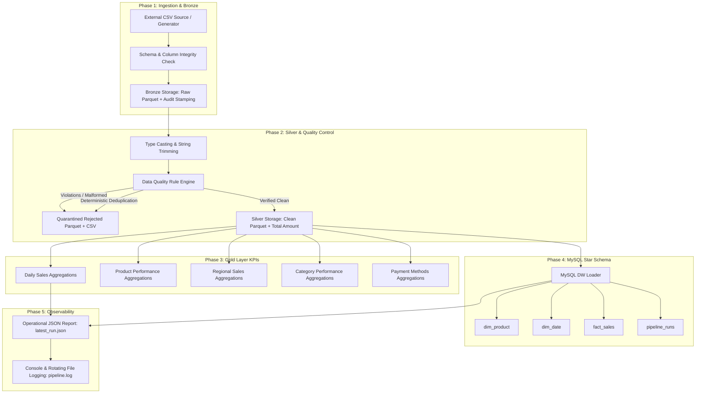
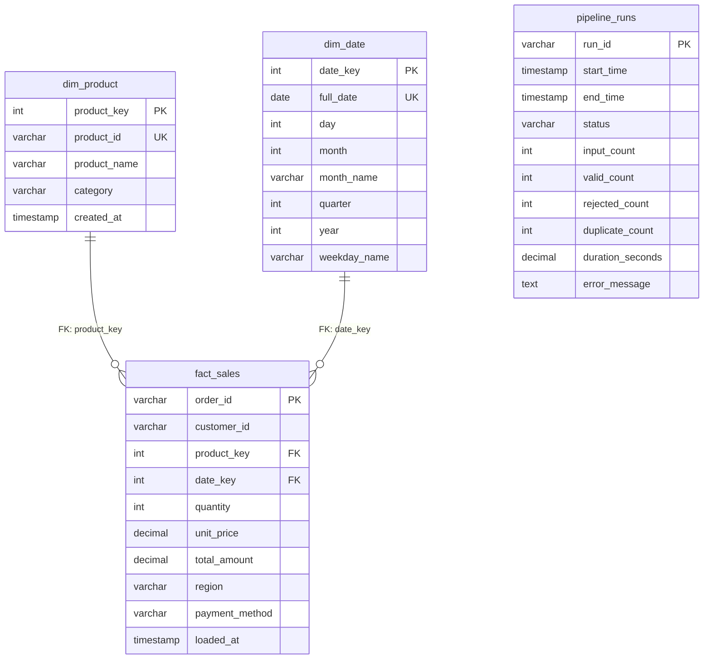

# RetailPulse — Architecture & System Design Document

## 1. Executive Summary
**RetailPulse** is an enterprise-inspired batch retail data engineering pipeline implemented in **PySpark 3.5**, **Apache Parquet**, and **MySQL 8/9**. It models the ingestion, validation, cleansing, aggregation, and analytical warehousing of e-commerce transactions adhering to the **Medallion Lakehouse Architecture** (Bronze, Silver, Gold) combined with a dimensional **Kimball Star Schema Data Warehouse**.

---

## 2. End-to-End Architectural Pipeline Flow

---

## 3. The Medallion Architecture Strategy

### Bronze Layer (`data/bronze/`)
* **Role**: Raw data retention and fidelity.
* **Mechanism**: Verbatim ingestion of source CSV records as Parquet without schema mutations.
* **Audit Stamping**: Injects `_ingestion_timestamp` (UTC) and `_source_file` metadata columns.
* **Architectural Rationale**: Storing raw Bronze data allows historical reprocessing if downstream business logic evolves. Note: While raw data retention is foundational, enterprise data lineage also incorporates transformation catalogs and upstream provenance tracking (e.g., OpenLineage / Apache Atlas).

### Silver Layer (`data/silver/`)
* **Role**: Validated, cleansed, and enriched single-source-of-truth.
* **Mechanism**:
  - Enforces explicit schemas (`IntegerType`, `DecimalType(10, 2)`, `DateType`).
  - Trims all string attributes.
  - Implements financial precision: `total_amount = round(quantity * unit_price, 2)`.
  - Routes malformed records (null required keys, negative quantities, negative prices, invalid calendar dates) to quarantine.
  - Resolves duplicate `order_id` values deterministically using PySpark `Window.partitionBy("order_id").orderBy("_ingestion_timestamp")`.
* **Storage**: Columnar Parquet with Snappy compression.

### Rejected / Quarantine Layer (`data/rejected/`)
* **Role**: Operational observability and bad-record audit trail.
* **Mechanism**: Isolates invalid records tagged with explicit business rejection codes (`MISSING_CUSTOMER_ID`, `INVALID_ORDER_DATE`, `DUPLICATE_ORDER_ID`, `INVALID_QUANTITY`, `INVALID_UNIT_PRICE`, `MISSING_PRODUCT_NAME`).
* **Storage**: Parquet and CSV for rapid auditor inspection.

### Gold Layer (`data/gold/`)
* **Role**: High-performance pre-aggregated analytical marts for BI and executive dashboards.
* **Outputs**:
  1. `daily_sales`: Daily order counts, volume, and gross revenue.
  2. `product_performance`: Units sold, total revenue, and average realized selling price.
  3. `regional_sales`: Regional revenue distribution.
  4. `category_performance`: Category volume and revenue.
  5. `payment_methods`: Transaction volume and ticket sizes per payment rail.

---

## 4. Kimball Star Schema Data Warehouse (`retailpulse_dw`)

### Grain & Keys
- **Transaction Grain**: Exactly one row in `fact_sales` represents one unique, verified customer transaction.
- **Surrogate vs Natural Keys**:
  - `dim_product.product_id` is the natural key; `product_key` is an integer surrogate key to isolate warehouse joins from operational source system mutations.
  - `dim_date.date_key` uses integer date format (`YYYYMMDD`) to enable index pruning and partition elimination.
- **Idempotency Strategy**: Batch upsert using parameterized SQL (`INSERT INTO ... ON DUPLICATE KEY UPDATE`) encapsulated inside explicit database transactions. If any batch operation fails, the transaction is immediately rolled back, preventing uncommitted or duplicated fact records.
