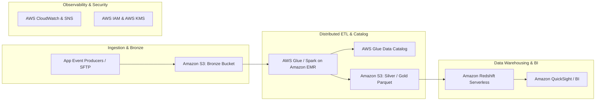
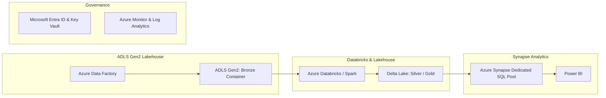
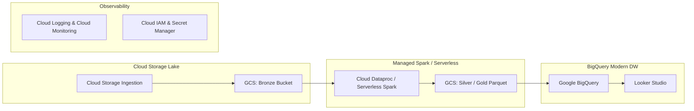

# RetailPulse — Cloud Architecture & Migration Blueprint

This document details how the local **RetailPulse** data engineering pipeline maps to enterprise big data architectures across the three major hyperscale cloud platforms: **AWS**, **Microsoft Azure**, and **Google Cloud Platform (GCP)**.

---

## 1. AWS Big Data Reference Architecture

### Component Mapping:
1. **Ingestion & Storage**:
   - **Amazon S3**: Multi-bucket strategy (`s3://retailpulse-bronze/`, `s3://retailpulse-silver/`, `s3://retailpulse-gold/`). S3 Intelligent-Tiering automatically migrates historical Bronze partitions to Glacier Instant Retrieval after 90 days.
2. **Distributed Compute**:
   - **AWS Glue (Serverless Spark)**: For scheduled batch ETL runs without managing cluster infrastructure.
   - **Amazon EMR on EC2 (or EMR Serverless)**: For high-volume multi-terabyte workloads, leveraging EC2 Spot instances for worker nodes to reduce compute costs by up to 70%.
3. **Data Cataloging**:
   - **AWS Glue Data Catalog**: Automatically crawls S3 Parquet directories to register external tables, partition metadata, and schemas.
4. **Analytical Serving**:
   - **Amazon Redshift Serverless**: Columnar MPP data warehouse. Uses `COPY` commands or Redshift Spectrum to query Gold S3 Parquet tables directly with low latency.
5. **Security & Cost Optimization**:
   - **AWS KMS**: Server-Side Encryption (SSE-KMS) with Customer Managed Keys.
   - **IAM**: Principle of Least Privilege role-based access control; credentials managed via AWS Secrets Manager.
   - **Monitoring**: AWS CloudWatch logs Spark driver metrics; CloudWatch Alarms send SNS alerts on pipeline failure.

---

## 2. Microsoft Azure Big Data Reference Architecture

### Component Mapping:
1. **Storage**:
   - **Azure Data Lake Storage Gen2 (ADLS Gen2)**: Hierarchical namespace enables directory-level atomic renames, accelerating Spark write operations.
2. **Orchestration & Ingestion**:
   - **Azure Data Factory (ADF)**: Orchestrates pipeline triggers, dependency graphs, and data movement from POS source systems.
3. **Processing**:
   - **Azure Databricks**: Managed Spark runtime utilizing the Delta Lake storage layer (ACID transactions, time travel, schema enforcement).
4. **Serving**:
   - **Azure Synapse Analytics**: Dedicated SQL Pools for enterprise dimensional reporting and Serverless SQL Pools for ad-hoc lakehouse queries.
5. **Governance**:
   - **Microsoft Entra ID (formerly Azure AD)**: Role-Based Access Control (RBAC).
   - **Azure Key Vault**: Stores JDBC credentials securely without hardcoding in notebook configurations.

---

## 3. Google Cloud Platform (GCP) Reference Architecture

### Component Mapping:
1. **Storage**:
   - **Google Cloud Storage (GCS)**: Standard storage for hot ingestion; Nearline/Coldline lifecycle rules for archived Bronze transaction data.
2. **Processing**:
   - **Dataproc Serverless for Spark**: Executes PySpark batch jobs directly without manual cluster provisioning or scaling configurations.
3. **Serving & Analytics**:
   - **Google BigQuery**: Enterprise serverless data warehouse. Gold Parquet data can be loaded directly or queried in place via BigQuery External Tables (BigLake). Leverages BigQuery Partitioning (by `order_date`) and Clustering (by `region`, `product_id`).
4. **Observability & Security**:
   - **Cloud Monitoring / Cloud Logging**: Captures structured JSON run reports and triggers Pub/Sub alerting upon task failure.
   - **Secret Manager & Cloud IAM**: Secure database credentials and fine-grained column-level access control.

---

## 4. Cross-Platform Architectural Summary

| Dimension | AWS | Azure | GCP |
| :--- | :--- | :--- | :--- |
| **Object Lake Storage** | Amazon S3 | ADLS Gen2 | Google Cloud Storage |
| **Managed Spark Engine** | AWS Glue / Amazon EMR | Azure Databricks / Synapse | Dataproc Serverless |
| **Data Warehouse** | Amazon Redshift | Azure Synapse SQL Pool | Google BigQuery |
| **Workflow Orchestration** | AWS Step Functions / MWAA | Azure Data Factory | Cloud Composer (Airflow) |
| **Security & Secrets** | AWS IAM & Secrets Manager | Entra ID & Key Vault | Cloud IAM & Secret Manager |
| **Primary BI Layer** | Amazon QuickSight | Microsoft Power BI | Google Looker |
